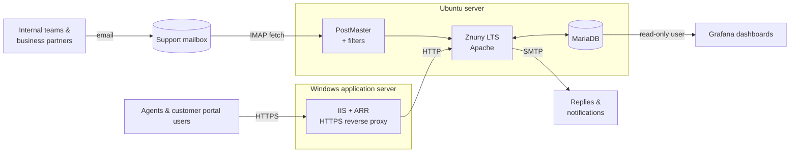
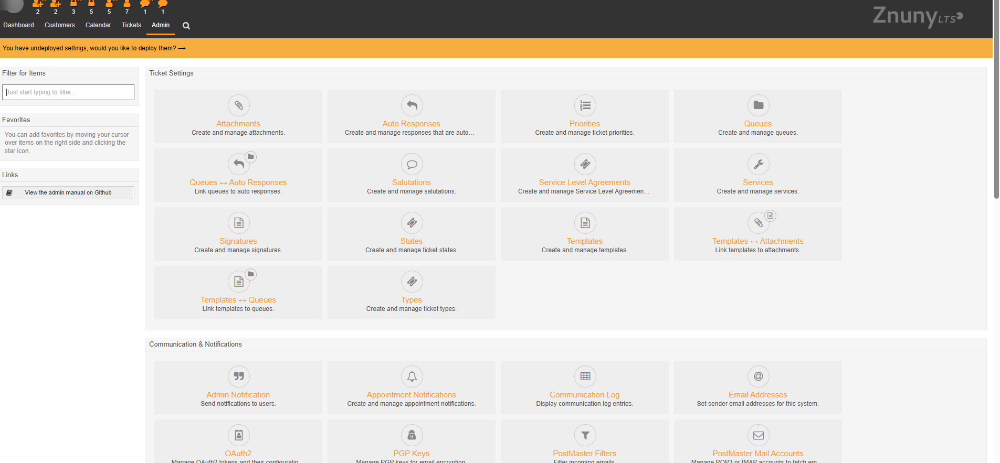
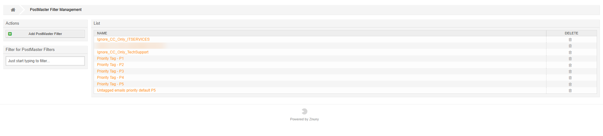
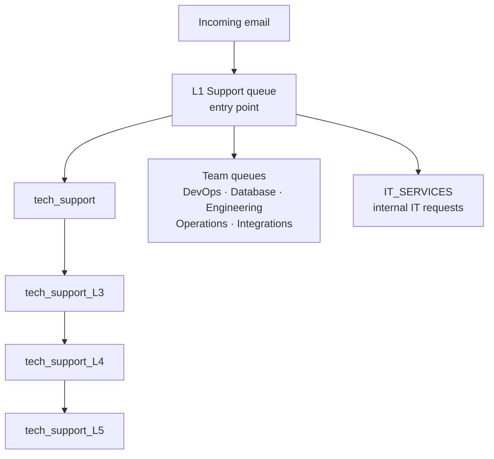
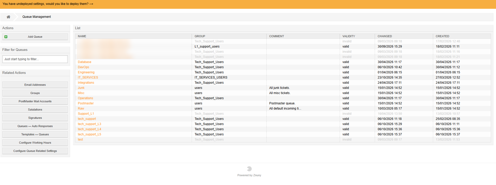
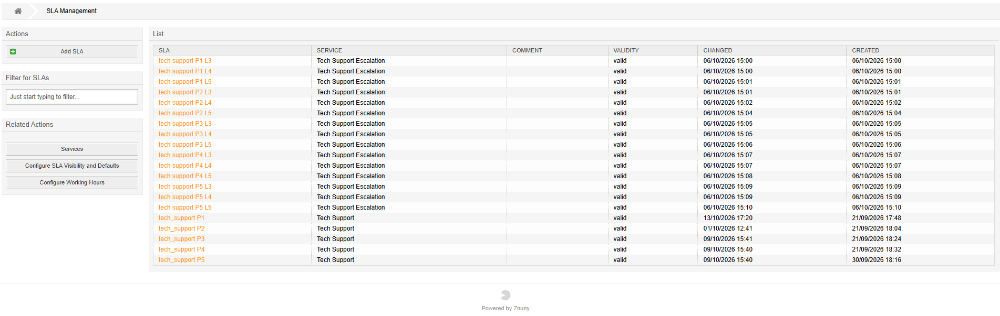
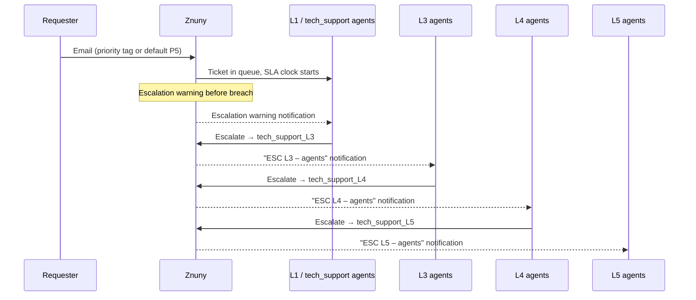
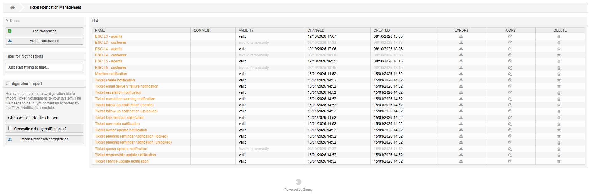
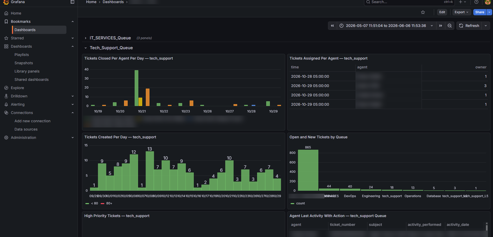

# 🎫 ITSM Helpdesk with Znuny: Email-Driven Ticketing, SLA Escalation & Grafana Analytics

> Deployed and configured **Znuny LTS** (the open-source OTRS fork) as the internal IT service desk for a fintech company. Support requests that used to live in shared inboxes now arrive as tickets through **IMAP**, get **prioritised automatically by PostMaster filters**, move through **tiered support queues (L1 → L5)** with **per-priority SLAs and escalation notifications**, and are tracked on a **Grafana dashboard built directly on the Znuny database**.


> ℹ️ Sanitized write-up of a production deployment. Email addresses, company domains, people, and ticket contents are removed or blurred.

---

## 📑 Table of Contents

1. [Overview](#1-overview)
2. [Architecture](#2-architecture)
3. [Installation & Hosting](#3-installation--hosting)
4. [Email Integration (IMAP / SMTP)](#4-email-integration-imap--smtp)
5. [PostMaster Filters: Inbound Parsing](#5-postmaster-filters-inbound-parsing)
6. [Queue Design & Permissions](#6-queue-design--permissions)
7. [Services, SLAs & Escalation](#7-services-slas--escalation)
8. [Notifications, Signatures & Customer Portal](#8-notifications-signatures--customer-portal)
9. [Grafana Analytics on the Znuny Database](#9-grafana-analytics-on-the-znuny-database)
10. [Results](#10-results)
11. [Challenges & Solutions](#11-challenges--solutions)
12. [Repository Structure](#12-repository-structure)
13. [Future Improvements](#13-future-improvements)

---

## 1. Overview

| Area | Implementation |
|---|---|
| Platform | Znuny LTS on Ubuntu, MariaDB backend |
| Access | HTTPS through an IIS reverse proxy on a Windows application server |
| Intake | Support mailbox fetched over IMAP → tickets created automatically |
| Parsing | PostMaster filters: priority tags P1–P5, default P5, CC-only emails ignored |
| Routing | Entry queues per channel, team queues (DevOps, Database, Engineering, Operations, Integrations, IT Services), and escalation tiers L3 / L4 / L5 |
| SLAs | 5 priority-based SLAs plus 15 priority × tier escalation SLAs |
| Escalation | Tier-specific escalation notifications to agents |
| Reporting | Grafana dashboards querying MariaDB through a read-only user |

## 2. Architecture



**Why this layout**

- **Znuny on Linux** is the supported, most stable platform (Perl + Apache), while the company's public-facing web estate is Windows/IIS.
- **IIS as reverse proxy** puts the helpdesk behind the existing hostname, certificate, and firewall rules, so Znuny itself never faces the network directly.
- **Grafana reads the database directly**, so reporting needs no Znuny add-ons and puts no load on the web UI.

## 3. Installation & Hosting

| Component | Choice |
|---|---|
| OS | Ubuntu Server |
| Application | Znuny LTS (Apache + mod_perl) |
| Database | MariaDB |
| Front door | IIS with URL Rewrite + Application Request Routing (ARR), HTTPS terminated on IIS |

**Install outline**

1. Install prerequisites (Apache, Perl modules, MariaDB) and unpack Znuny to `/opt/znuny`.
2. Create the database with `utf8mb4` and set `max_allowed_packet` / `innodb_log_file_size` as Znuny requires.
3. Run the web installer, then enable the **Znuny daemon** and **cron** jobs (needed for mail fetching, escalations, and notifications).
4. On IIS, add the reverse-proxy site using [`reverse-proxy/web.config`](reverse-proxy/web.config).
5. In Znuny SysConfig, set **`HttpType` = `https`** and **`FQDN`** to the public hostname, so links in emails and redirects point to the proxy rather than the internal server.



## 4. Email Integration (IMAP / SMTP)

- **Inbound:** a **PostMaster Mail Account** polls the support mailbox over IMAP. Each new email becomes a ticket (or a follow-up if it carries an existing ticket number) and is dispatched to the entry queue.
- **Outbound:** agent replies, auto-responses, and notifications go out through SMTP with the support address as sender, so customers can reply to keep the thread on the same ticket.
- **Multiple intake addresses** were consolidated: older per-brand support addresses were retired (set to invalid) in favour of a single L1 support mailbox.

## 5. PostMaster Filters: Inbound Parsing

Filters run on every incoming email **before** the ticket is created and set Znuny's `X-OTRS-*` headers:

| Filter | Matches | Action |
|---|---|---|
| `Priority Tag - P1` … `P5` | Priority tag in the email | Sets ticket priority P1–P5 |
| `Untagged emails priority default P5` | No priority tag | Sets priority **P5**, so nothing is created without a priority |
| `Ignore_CC_Only_<mailbox>` (×3) | Support address only in **CC**, not in **To** | `X-OTRS-Ignore: yes`: no ticket created |



**Why the CC-only filters matter:** people often CC the support address on long internal threads. Without these filters, every "reply all" created a new ticket, flooding the queue with noise and duplicates.

**Why default P5:** every ticket gets a priority on arrival, so SLA timers always start. Senders can raise urgency by tagging the email.

## 6. Queue Design & Permissions





| Group | Queues | Who |
|---|---|---|
| `L1_support_users` | L1 entry queue | First-line support |
| `Tech_Support_Users` | tech_support, L3–L5, team queues | Technical support & engineering tiers |
| `IT_SERVICES_USERS` | IT_SERVICES | Internal IT team |

- Queue access is controlled through **groups**, so each team sees only its own work.
- Default Znuny queues (`Raw`, `Junk`, `Misc`, `Postmaster`) are kept for system use, and test queues are set **invalid** rather than deleted to preserve history.
- Each team has its own **signature**, so replies identify the responding team.

## 7. Services, SLAs & Escalation

Two **services** carry the SLA structure:

| Service | SLAs | Purpose |
|---|---|---|
| **Tech Support** | `tech_support P1` … `P5` (5 SLAs) | Response and solution targets per priority for first-line handling |
| **Tech Support Escalation** | `tech support P{1-5} L{3-5}` (15 SLAs) | Separate targets for each priority **at each escalation tier** |



**Why a priority × tier matrix?** One SLA per priority can't express that a P1 needs a faster answer from a senior engineer (L3) than an L5 escalation does, or the reverse. The 5 × 3 matrix gives each tier its own clock for each priority.

**Escalation flow**



The escalation matrix (who sits at each tier) and turnaround times per priority were demoed to management and finalised together with business stakeholders (sales, finance, operations).

## 8. Notifications, Signatures & Customer Portal

| Notification | Status | Purpose |
|---|---|---|
| `ESC L3 / L4 / L5 – agents` | Active | Alert the right tier when a ticket escalates to it |
| `ESC L3 / L4 / L5 – customer` | Prepared, temporarily disabled | Tell the requester their ticket was escalated (to be enabled after rollout) |
| Ticket escalation / escalation warning | Active | Standard SLA breach and pre-breach alerts |
| Queue update notification | Disabled | Not needed once tier-specific escalation notifications were in place |



**Customer portal:** internal departments (e.g. Finance, Operations, Sales) were set up as **customer companies**, with their staff as customer users. They can raise and track their own tickets instead of chasing updates by email.

## 9. Grafana Analytics on the Znuny Database

Znuny's built-in statistics are limited, so a Grafana dashboard was built **directly on MariaDB**, with one collapsible row per queue.



| Panel | Type | Query |
|---|---|---|
| Tickets closed per agent per day | Bar chart | [`01-tickets-closed-per-agent-per-day.sql`](grafana/sql/01-tickets-closed-per-agent-per-day.sql) |
| Tickets created per day | Bar chart with threshold colours | [`02-tickets-created-per-day.sql`](grafana/sql/02-tickets-created-per-day.sql) |
| Open & new tickets by queue | Bar chart | [`03-open-and-new-by-queue.sql`](grafana/sql/03-open-and-new-by-queue.sql) |
| Tickets assigned per agent | Table | [`04-tickets-assigned-per-agent.sql`](grafana/sql/04-tickets-assigned-per-agent.sql) |
| High-priority open tickets | Table | [`05-high-priority-open.sql`](grafana/sql/05-high-priority-open.sql) |
| Agent last activity with action | Table | [`06-agent-last-activity.sql`](grafana/sql/06-agent-last-activity.sql) |

**How it works**

- Data source: MySQL/MariaDB plugin using a **read-only** account ([`00-readonly-user.sql`](grafana/sql/00-readonly-user.sql)).
- Activity metrics come from `ticket_history` (`NewTicket`, `StateUpdate`, `OwnerUpdate`), joined to `ticket_state_type` so "closed" means **any** closed state, not one hard-coded state name.
- Grafana macros (`$__timeFilter`, `$__timeGroupAlias`) make every panel follow the dashboard's time picker.

**What it surfaced:** the backlog panel made the gap between ticket **intake** and **closure** visible at a glance and showed which queue was holding most of the unprocessed tickets, so triage effort could go where it was needed.

## 10. Results

- **Single intake point:** support requests from email are captured as tickets automatically; nothing gets lost in a shared inbox.
- **Every ticket has a priority and an SLA** from the moment it arrives.
- **Noise reduction:** CC-only filters stop reply-all threads from creating duplicate tickets.
- **Clear ownership** through tiered queues and escalation notifications.
- **Visibility for management:** per-agent closures, daily intake, and backlog per queue in Grafana.

## 11. Challenges & Solutions

| Challenge | Solution |
|---|---|
| Reply-all emails created a new ticket each time | PostMaster filters ignore emails where the support address is only in CC |
| Tickets arriving without a priority meant no SLA clock | Default-P5 filter for untagged emails; P1–P5 tag filters for urgent ones |
| One SLA per priority couldn't model tiered support | 15 priority × tier escalation SLAs under a dedicated service |
| Multiple legacy support addresses split the intake | Consolidated into one L1 mailbox; old queues set invalid, keeping history |
| Stock reporting too basic for management | Grafana dashboards on MariaDB with a read-only user |
| Getting escalation rules agreed across teams | Demoed the working flow to management first, then worked out the escalation matrix and turnaround times with business stakeholders |

## 12. Repository Structure

```
Znuny-ITSM-Helpdesk/
├── README.md
├── grafana/sql/
│   ├── 00-readonly-user.sql
│   ├── 01-tickets-closed-per-agent-per-day.sql
│   ├── 02-tickets-created-per-day.sql
│   ├── 03-open-and-new-by-queue.sql
│   ├── 04-tickets-assigned-per-agent.sql
│   ├── 05-high-priority-open.sql
│   └── 06-agent-last-activity.sql
├── reverse-proxy/
│   └── web.config            # IIS URL Rewrite + ARR rules
└── docs/screenshots/
```

## 13. Future Improvements

- **Monitoring alerts → tickets:** route Prometheus/Grafana alert emails through PostMaster filters into the DevOps queue with auto-priority.
- **GenericAgent auto-escalation:** move breached tickets to the next tier automatically instead of manually.
- Enable the prepared **customer escalation notifications**.
- **Custom agent and customer UI** on the Znuny REST/GenericInterface API, replacing the stock interface.
- **Grafana alerting** on backlog growth or SLA breaches per queue.

---

**Author:** Hussain Malik
